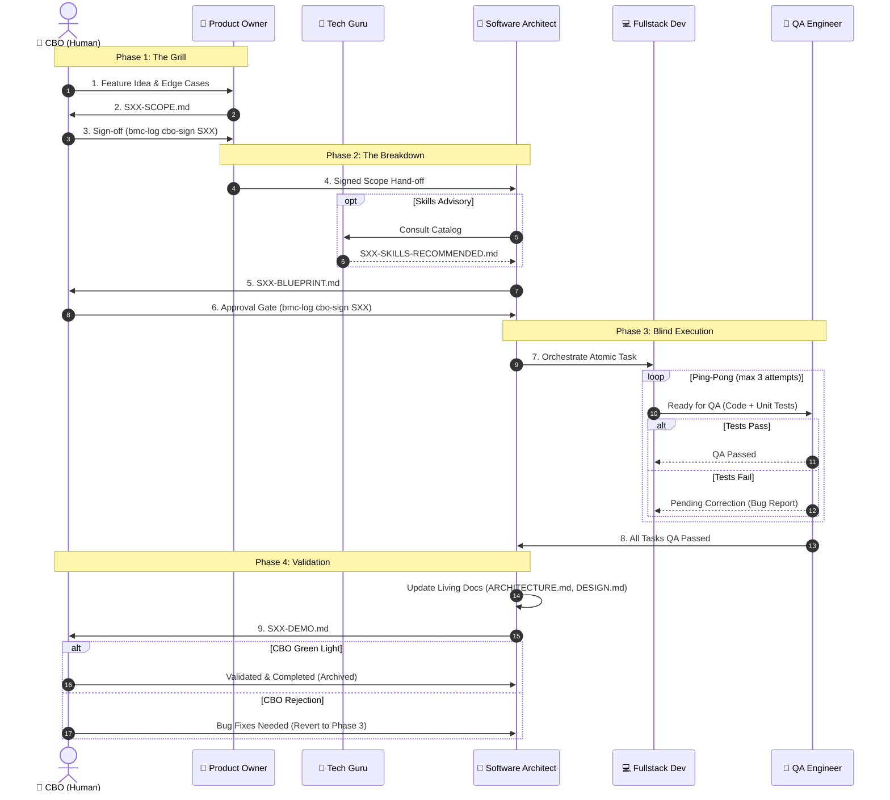

# Baremetal-Crew (BMC)

A rigid, minimalist, and highly structured human/agent development framework for local, monolithic software projects.

---

## 📖 What is Baremetal-Crew?
Baremetal-Crew enforces a linear, watertight workflow between a Human (**CBO**, Chief Baremetal Officer) and a Crew of specialized AI agents:
1.  **Product Owner (PO):** Interrogates the CBO to freeze functional scope (`SXX-SCOPE.md`).
2.  **Software Architect (SA):** Breaks down the scope into technical designs and atomic tasks (`SXX-BLUEPRINT.md`).
3.  **Fullstack Dev:** Implements code and unit tests blindly task-by-task.
4.  **QA Engineer:** Automates integration/E2E tests to verify implementation.
5.  **Tech Guru:** Evaluates technical needs and indexes/recommends external skills catalog.

For detailed information on the philosophy, roles, and the 4 inviolable phases, read the [Baremetal-Crew Manifesto](knowledge/MANIFESTO.md).

### 🔄 Slice Execution Lifecycle

Every development cycle operates as an isolated slice (`SXX`, e.g., `S01`, `S02`) that progresses sequentially through 4 phases:


```text
│ I. Phase 1: The Grill (Product Owner & CBO)
│   ├─ Interrogate CBO on requirements, constraints, and edge cases
│   ├─ Draft functional scope (.bmc-stuff/work/SXX-SCOPE.md)
│   └─ Await CBO review and sign-off on SXX-SCOPE.md
│ II. Phase 2: The Breakdown (Software Architect)
│   ├─ Draft technical blueprint (.bmc-stuff/work/SXX-BLUEPRINT.md) and atomic tasks
│   ├─ (Optional) Run Tech Guru audit & recommend skills (.bmc-stuff/work/SXX-SKILLS-RECOMMENDED.md)
│   └─ Await CBO review and sign-off on SXX-BLUEPRINT.md
│ III. Phase 3: Blind Execution (Dev & QA Subagents)
│   ├─ Implement tasks and unit tests blindly (Fullstack Dev)
│   ├─ Automate integration/E2E tests and enforce ping-pong limit (QA Engineer)
│   └─ Verify all tasks reach "QA Passed"
│ IV. Phase 4: Validation (Software Architect & CBO)
│   ├─ Update root living documentation (ARCHITECTURE.md, DESIGN.md, README.md)
│   ├─ Generate manual verification guide (.bmc-stuff/work/SXX-DEMO.md)
│   └─ Await CBO validation sign-off (Green Light -> Completed / Abort)
```

---

## 🚀 Installation & Setup

You can install Baremetal-Crew in a target project directory using either of the following options:

### Option 1: Local Clone Installation
Use this option if you have already cloned the `baremetal-crew` repository locally. Run the installer script and pass the target project directory:

```bash
./install.sh /path/to/target/project -y -i
```

### Installer Flags & Options

The `install.sh` script supports the following command-line flags:

| Flag | Short | Description |
| :--- | :--- | :--- |
| `-i`, `--index-skills` | `-i` | Automatically clone, index pre-approved technical skills libraries, and update matching skills in `.agents/skills/` during install. |
| `-y`, `--yes` | `-y` | Non-interactive mode (automatically confirms installation prompts). |
| `-h`, `--help` | `-h` | Display the installer help message and options. |
---

### Option 2: One-Command Remote Installation (Standalone)
Use this option to install the framework directly from GitHub without cloning the repo. The installer will automatically download and unpack the latest release package.

Navigate to your target project folder and run:

```bash
curl -L "https://raw.githubusercontent.com/devmunoz/baremetal-crew/master/install.sh" | bash
```

*Note: To specify the target directory explicitly, pass it as a parameter using the `bash -s` syntax:*

```bash
curl -L "https://raw.githubusercontent.com/devmunoz/baremetal-crew/master/install.sh" | bash -s -- /path/to/target/project
```
---
---

## 🛠️ Helper Utilities & Skills Management

Baremetal-Crew provides centralized CLI utilities under `.bmc-stuff/bin/`:

*   **`.bmc-stuff/bin/bmc-log`**: Manages execution state, phase transitions, task logs, and command error audits in `.bmc-stuff/crew.db`.
*   **`.bmc-stuff/bin/bmc-index-skills`**: Clones and indexes pre-approved skills repositories into `.bmc-stuff/skills-cache/` and synchronizes matching skills under `.agents/skills/`.

### Skills Indexer & Updater CLI Options (`bmc-index-skills`)

| Flag / Option | Description |
| :--- | :--- |
| `-t`, `--target <path>` | Specify target project directory path (defaults to working directory). |
| `-c`, `--check` | Check local `.agents/skills/` for available updates without overwriting files. |
| `-u`, `--update-local` | Automatically update local `.agents/skills/` from primary crew skills and cache (default: enabled). |
| `--no-update-local` | Skip updating local `.agents/skills/`. |
| `-s`, `--silent` | Run silently without verbose terminal logs. |

Example usage:
```bash
# Index skills catalog and update matching .agents/skills in target project
.bmc-stuff/bin/bmc-index-skills --target /path/to/project

# Check for local skill updates without overwriting
.bmc-stuff/bin/bmc-index-skills --check
```

## 🌟 Credits & Skill Sources

The primary crew skills and advisory skills indexing catalogs are inspired by and sourced from the following repositories:
*   [addyosmani/agent-skills](https://github.com/addyosmani/agent-skills) – General software engineering agent skills.
*   [mattpocock/skills](https://github.com/mattpocock/skills) – Engineering triage, domain modeling, and testing skills.
*   [obra/superpowers](https://github.com/obra/superpowers) – Adversarial and verification skills.
*   [JuliusBrussee/caveman](https://github.com/JuliusBrussee/caveman) – Ultra-compressed token communication mode.
*   [danyuchn/asd-ste100-skill](https://github.com/danyuchn/asd-ste100-skill) – Simplified Technical English (ASD-STE100) communication standard.
*   [vercel-labs/agent-skills](https://github.com/vercel-labs/agent-skills) – Web design guidelines, React best practices, and component patterns.
*   [GoogleChrome/modern-web-guidance](https://github.com/GoogleChrome/modern-web-guidance) – Modern web platform best practices, native APIs, and browser compatibility guidance.
